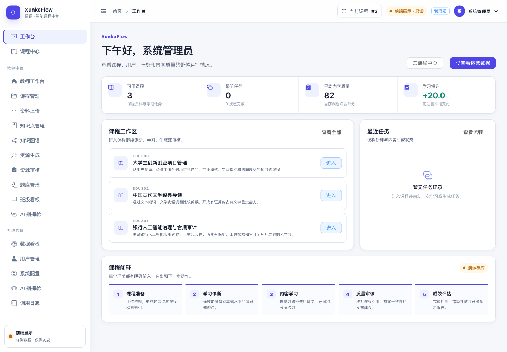

# 循课 · XunkeFlow

**循课——多智能体协作的个性化学习平台**

面向高校课程的个性化学习与教学管理平台。围绕课程资料，串联知识组织、前测诊断、学习画像、路径规划、资源生成、质量校验、教师审核和学习成效反馈。

本仓库包含 **Vue 前端、FastAPI 后端、Electron 桌面端、演示课程、测试和部署脚本**。GitHub Actions 发布的是原前端的只读展示版；完整服务可在本地运行。

源码仓库：[wyyy5111/xunke](https://github.com/wyyy5111/xunke)。[下载完整源码](https://github.com/wyyy5111/xunke/archive/refs/heads/main.zip)后，按下方“运行完整程序”启动。默认使用 Mock 演示模式，在线 AI 需要按模型配置说明设置有效 API Key。



## 在线展示

网站沿用现有页面、样式和三角色工作台，提供课程浏览、知识图谱、讲义、思维导图、学习报告、班级看板、智能体记录及后台数据展示。

| 角色 | 展示账号 | 密码 |
| --- | --- | --- |
| 管理员 | `admin` | `123456` |
| 教师 | `teacher` / `teacher2` | `123456` |
| 学生 | `student01` | `123456` |

网页中的账号与内容均为程序自带的公开演示数据。生成、提交测评、上传资料、修改配置等操作需要运行完整服务；展示站会明确提示，不会假装完成这些操作。展示账号不是正式身份认证，网页中不包含模型密钥或后端登录令牌。

## 发布到 GitHub Pages

1. 将本目录的**全部内容**放在仓库根目录，包括隐藏的 `.github`、`.gitignore` 等文件。不要在仓库中再套一层本文件夹。
2. 在仓库 **Settings → Pages → Build and deployment → Source** 选择 **GitHub Actions**。
3. 在 **Settings → Secrets and variables → Actions → Variables** 新建仓库变量 `ENABLE_PAGES`，值为 `true`。未设置时只检查源码，不部署网页。
4. 向默认分支推送代码，或在 **Actions → Quality checks and GitHub Pages** 手动运行。
5. 前后端检查通过后自动构建、发布。在 Actions 的 `github-pages` 部署结果和 Settings → Pages 中查看网站地址。

工作流自动适配仓库名称、用户主页和自定义域名配置。页面使用哈希路由，刷新课程详情不会依赖服务器路由重写。首次发布需要 GitHub Pages 已启用；无须配置模型密钥或第三方部署令牌。

详细步骤与排查：[GitHub 发布指南](docs/GITHUB_PAGES.md)。

## 本地预览展示网页

环境：Node.js 24（推荐 `.nvmrc` 中版本）。

```bash
cd frontend
npm ci
npm run dev:showcase
```

打开终端打印的地址。此模式不需要 Python、数据库或在线模型。

构建并预览与 Pages 相同的产物：

```bash
npm run build:showcase -- --base /xunke/
npm run preview -- --host 127.0.0.1
```

访问终端地址下的 `/xunke/`。实际发布时由工作流自动设置该路径。

## 运行完整程序

环境：Python 3.12、Node.js 24。首次启动安装依赖；`.env` 只保存在本地。

macOS / Linux：

```bash
bash scripts/start_dev.sh
```

Windows PowerShell：

```powershell
powershell -ExecutionPolicy Bypass -File scripts/start_windows.ps1
```

脚本启动原有前后端服务，保留资料上传、智能体运行、教师审核、测评和报告导出等完整功能。默认使用本地演示引擎；在线模型配置见 [模型配置说明](docs/02_模型配置与数据说明.md)。运行参数以根目录 `.env.example` 为准。

也可使用原有容器部署：

```bash
cp .env.example .env
# 本地编辑 .env，设置独立的 JWT_SECRET。
docker compose up --build -d
```

桌面端的构建配置与 Windows / macOS 打包脚本保留在 `desktop/` 和 `scripts/`。安装包属于构建产物，适合单独放入 GitHub Releases；仓库保留构建这些安装包所需的源码。

## 项目结构

```text
.
├── .github/workflows/     自动检查、Pages 发布、Windows 安装包验证
├── backend/              FastAPI、数据模型、检索、十智能体及测试
├── frontend/             Vue 页面、组件、样式及前端测试
│   ├── public/showcase/   公开演示快照和可下载的样例报告
│   └── src/showcase/      只读展示适配器
├── desktop/              Electron 启动与桌面打包配置
├── demo_data/            原有课程与演示资料
├── scripts/              启动、数据初始化、快照导出与检查工具
├── docs/                 使用、架构、部署与验收说明
├── licenses/             第三方依赖许可证
├── .env.example          本地服务配置模板
└── docker-compose.yml    完整服务的容器编排
```

## 验证与维护

```bash
cd frontend
npm ci
npm run lint
npm run typecheck
npm test
npm run build
npm run build:showcase
```

```bash
# 在项目根目录，使用已安装后端依赖的 Python 环境
python -m pip install -r backend/requirements.txt
python scripts/check_repository.py
cd backend
python -m pytest -q
```

展示数据由 `python scripts/export_showcase.py` 从**临时数据库中的原始演示数据**和真实后端接口导出，不读取现有业务数据库或 `.env`。更新后请检查页面再提交。已有快照随仓库提交，普通发布不需要重新生成。

参见 [架构说明](docs/ARCHITECTURE.md)、[贡献约定](CONTRIBUTING.md) 和 [交付验证](docs/VALIDATION.md)。

## 使用与权利说明

原项目权利说明及第三方许可证均保留。上传 GitHub 不自动授予项目整体开源许可；详见 [LICENSE-NOTICE.md](LICENSE-NOTICE.md)、[第三方声明](THIRD_PARTY_LICENSES.txt) 和 `licenses/`。演示数据与评测数值不代表真实学生实测或模型效果保证。
